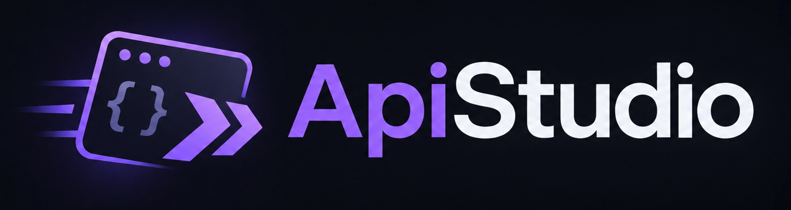
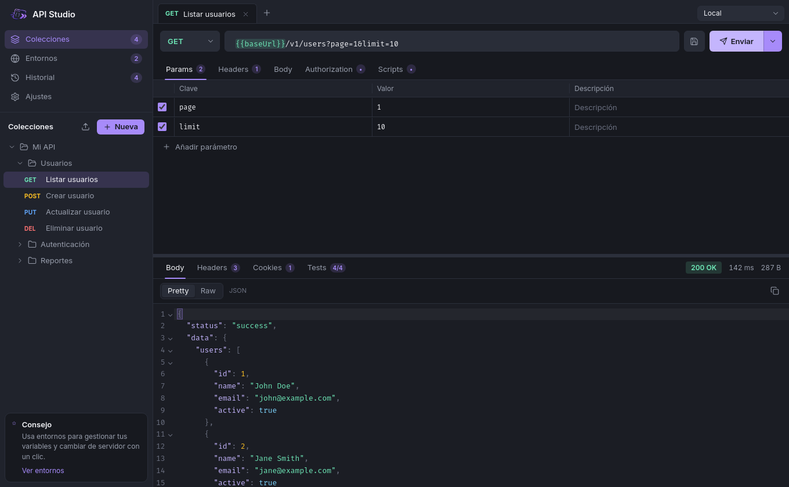
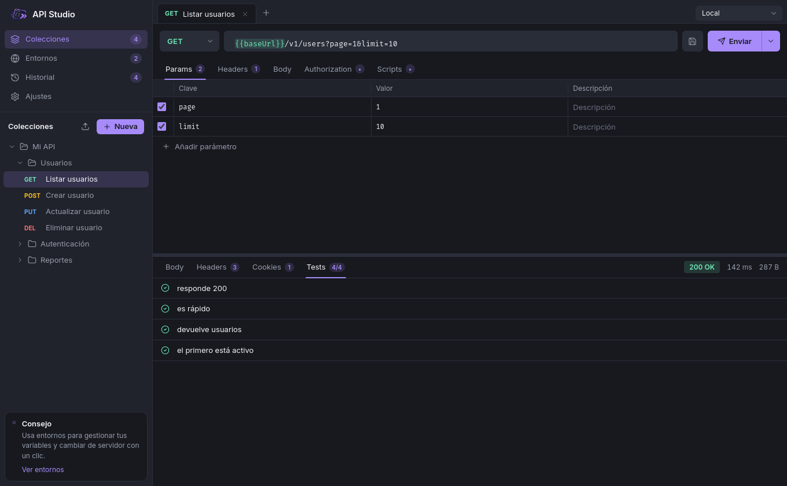
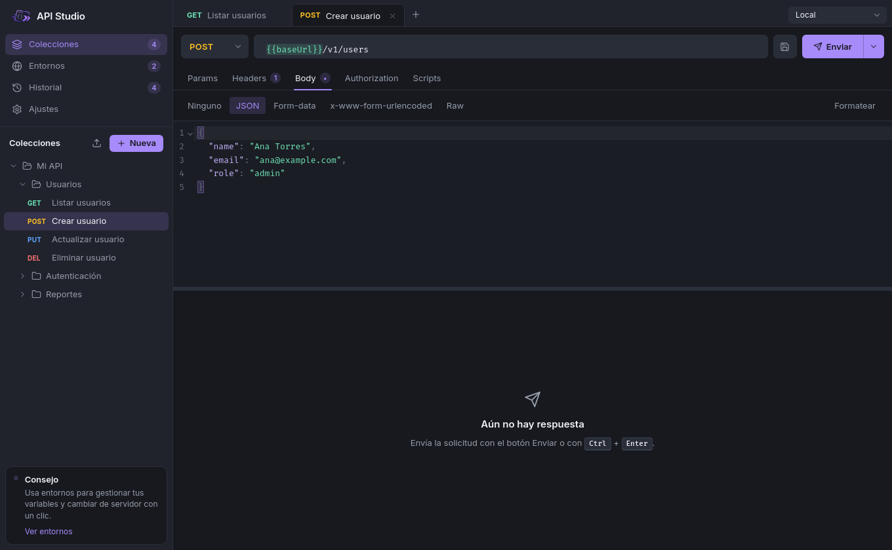
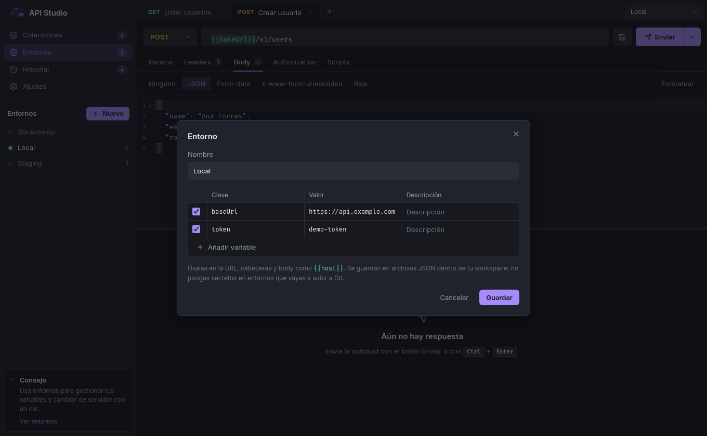
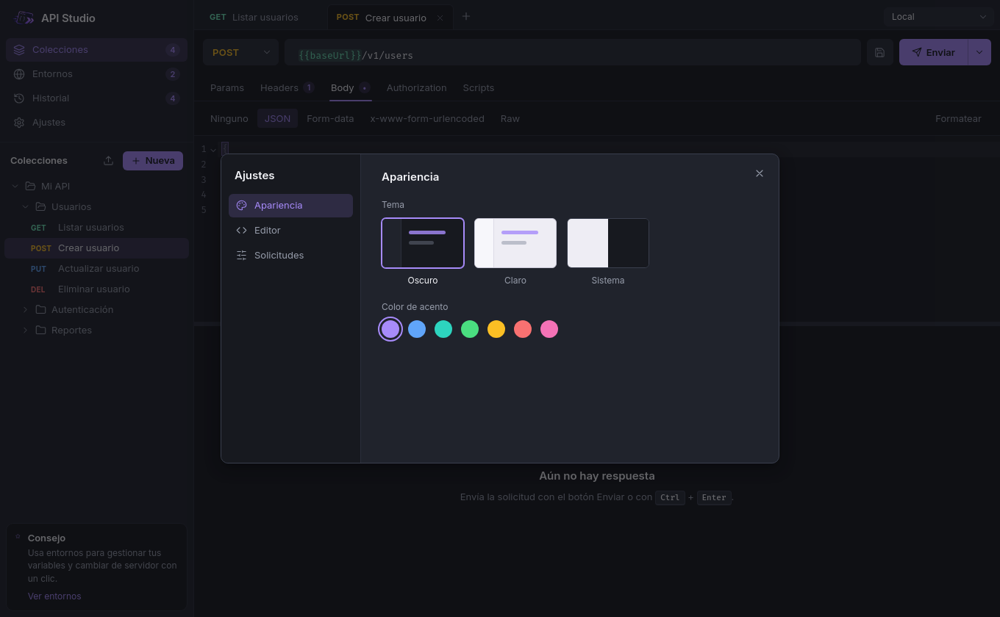
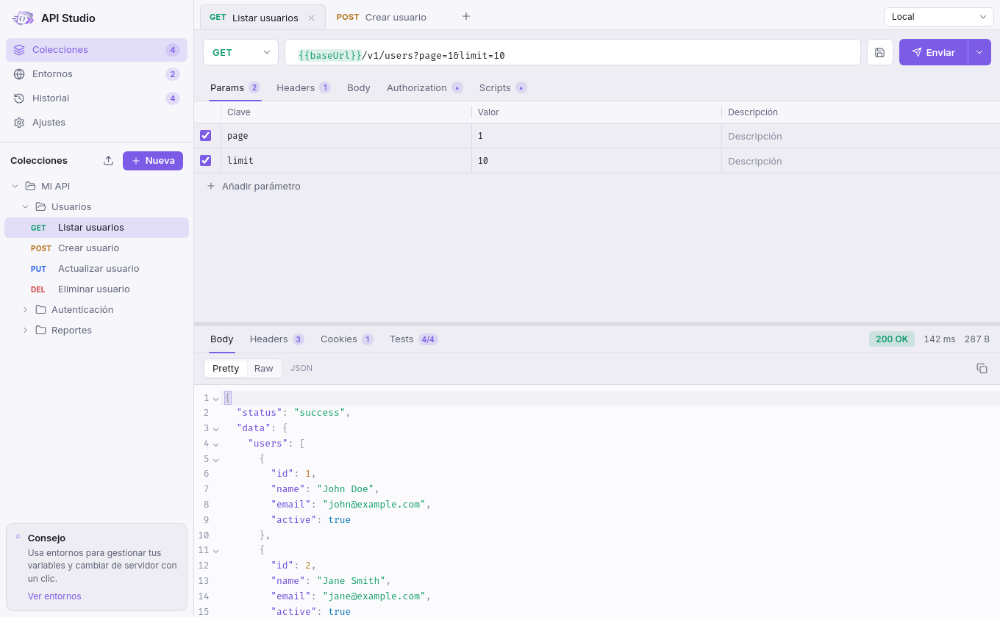

<p align="center">
  
</p>

<p align="center">
  Cliente HTTP de escritorio, rápido y 100 % local. Sin cuentas, sin nube, sin telemetría.
</p>

<p align="center">
  <a href="LICENSE"></a>
  <a href="https://github.com/DerianMolinaLopez/ApiStudio/releases/latest"></a>
  
</p>

<p align="center">
  
</p>

ApiStudio sirve para desarrollar y probar APIs sin depender de un servicio externo: no pide iniciar sesión, no sincroniza nada con la nube y todo se guarda en archivos JSON legibles que puedes versionar con Git. El motor HTTP está escrito en Rust.

## Descargar

**[⬇ Última versión (Releases)](https://github.com/DerianMolinaLopez/ApiStudio/releases/latest)**

| Sistema | Archivo | Instalar |
| --- | --- | --- |
| Fedora / RHEL / openSUSE | [`ApiStudio-0.1.0-1.x86_64.rpm`](https://github.com/DerianMolinaLopez/ApiStudio/releases/download/v0.1.0/ApiStudio-0.1.0-1.x86_64.rpm) | `sudo dnf install ./ApiStudio-0.1.0-1.x86_64.rpm` |
| Debian / Ubuntu | [`ApiStudio_0.1.0_amd64.deb`](https://github.com/DerianMolinaLopez/ApiStudio/releases/download/v0.1.0/ApiStudio_0.1.0_amd64.deb) | `sudo apt install ./ApiStudio_0.1.0_amd64.deb` |

Después abre **ApiStudio** desde el menú de aplicaciones o ejecuta `api-studio`.

> Los paquetes no están firmados. Windows y macOS todavía no tienen binario: por ahora se compila desde el código (ver [Ejecutarlo desde el código](#ejecutarlo-desde-el-código)).

## Qué puedes hacer

- **Enviar solicitudes** GET, POST, PUT, PATCH, DELETE, HEAD y OPTIONS, con tablas editables de Params y Headers.
- **Body** en JSON (con resaltado de sintaxis), form-data (con archivos), x-www-form-urlencoded y raw.
- **Autenticación** Basic, Bearer y API Key.
- **Respuesta** con estado en color, tiempo, tamaño, Body en Pretty / Raw / Preview HTML, Headers y Cookies.
- **Pestañas** para trabajar con varias solicitudes a la vez.
- **Colecciones y carpetas**: arrastra para reorganizar; cada solicitud es un archivo JSON.
- **Entornos** con variables `{{nombre}}` en URL, headers y body.
- **Historial** de solicitudes recientes, con búsqueda.
- **Importar y exportar**: comandos cURL, colecciones y entornos de Postman (v2.0/2.1); exportar a Postman y copiar como cURL.
- **Scripts y tests** en JavaScript (pre-request, post-response y aserciones), aislados del sistema.
- **Temas** Oscuro, Claro y Sistema, con 7 colores de acento.

<table>
  <tr>
    <td><br><sub>Tests sobre la respuesta</sub></td>
    <td><br><sub>Body JSON con resaltado</sub></td>
  </tr>
  <tr>
    <td><br><sub>Entornos con variables</sub></td>
    <td><br><sub>Temas y color de acento</sub></td>
  </tr>
  <tr>
    <td colspan="2"><br><sub>Tema claro</sub></td>
  </tr>
</table>

Atajos: `Ctrl+Enter` enviar · `Ctrl+S` guardar · `Ctrl+T` nueva pestaña · `Ctrl+W` cerrar pestaña.

## Tus datos y la seguridad

Todo es local. Esto es lo que se guarda y dónde:

```
~/Documentos/API Studio/
  collections/<colección>/<carpeta>/<solicitud>.json
  environments/<entorno>.json
```

- **Las contraseñas, tokens y API keys que escribas en una solicitud o en un entorno se guardan en texto plano** en esos archivos. Si vas a subir la carpeta a Git, revísala antes o deja los secretos fuera (por ejemplo, añade `environments/` a tu `.gitignore`).
- El **historial** no guarda credenciales: se redactan contraseñas, tokens, API keys y cabeceras sensibles.
- Los scripts corren en un Web Worker sin acceso a red ni a archivos y con límite de 5 s.

Detalle completo y cómo reportar una vulnerabilidad en [SECURITY.md](SECURITY.md).

## Ejecutarlo desde el código

Requisitos: Node 20+, Rust estable y las [dependencias de Tauri 2](https://v2.tauri.app/start/prerequisites/) (en Linux: `webkit2gtk-4.1` y `libsoup-3.0`).

```bash
git clone https://github.com/DerianMolinaLopez/ApiStudio.git
cd ApiStudio
npm install
npm run tauri dev        # abre la app con recarga en caliente
```

Otros comandos:

```bash
npm test                                           # tests del frontend (vitest)
npm run check                                      # tipos Svelte / TypeScript
cargo test --manifest-path src-tauri/Cargo.toml    # tests de Rust
npm run tauri build                                # genera los instaladores
```

<details>
<summary>Estructura del proyecto</summary>

```
src/                     Frontend (Svelte 5 + TypeScript)
  styles/tokens.css      Tokens de diseño: no usar colores sueltos en componentes
  lib/                   Lógica pura (solicitudes, importadores, scripts), stores y puente Tauri
  features/              request, response, sidebar, settings, import, welcome
  ui/                    Componentes base (Modal, Select, Menu, CodeEditor…)
src-tauri/src/           Backend (Rust)
  commands/              #[tauri::command] finos
  services/              http_engine, workspace, history (testeables sin Tauri)
  models/ · error.rs     Tipos serde compartidos y AppError
```

</details>

## Contribuir

¡Las contribuciones son bienvenidas! Lee la [guía de contribución](CONTRIBUTING.md): ahí están el flujo de ramas, el formato de commits y los checks que debe pasar tu Pull Request.

## Reportar un problema o proponer una idea

- 🐞 **Error:** [abre un issue](https://github.com/DerianMolinaLopez/ApiStudio/issues/new?template=bug.yml) con los pasos para reproducirlo, tu versión y sistema operativo. No pegues tokens ni datos privados.
- 💡 **Mejora:** [propónla aquí](https://github.com/DerianMolinaLopez/ApiStudio/issues/new?template=feature.yml).
- 🔒 **Vulnerabilidad:** repórtala en privado desde [Security Advisories](https://github.com/DerianMolinaLopez/ApiStudio/security/advisories/new).

## Roadmap

GraphQL, WebSocket, gRPC y SSE · OAuth 2.0 · mock servers · Collection Runner · proxy · imágenes y respuestas binarias · binarios para Windows y macOS · cifrar secretos en disco.

## Licencia

[MIT](LICENSE) © 2026 Derian Molina Lopez
